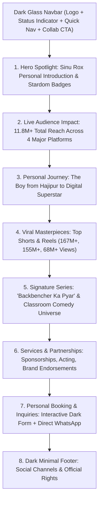

# 🖤 PERSONAL PORTFOLIO DESIGN & TECHNICAL ARCHITECTURE SPECIFICATION

**Identity:** Sinu Rox – Official Personal Creator Portfolio  
**Theme:** Ultra-Modern Dark Luxury / Obsidian Dark Theme  
**File Name:** `DESIGN.md`  
**Status:** Updated & Ready for Implementation

---

## 1. 🌟 Personal Portfolio Vision & Strategy

This website serves as the **Official Personal Portfolio** of **Sinu Rox** — Comedian, Actor, and YouTube Phenomenon (11.8M+ Total Community, 9.73M+ YouTube Subscribers).

### Core Goals:

1. **Personal Brand Showcase:** Establish Sinu Rox as a top-tier Indian entertainer, highlighting his personal journey from Hajipur (Bihar) to multi-million subscriber stardom.
2. **Personal Portfolio Structure:** Feature his biography, iconic characters, signature "Backbencher" series, top viral works, and media appearances.
3. **High-Ticket Brand Partnerships:** Dedicated sponsorship and collaboration portal for brands, directors, casting agencies, and event organizers.
4. **Direct Fan & Community Hub:** Central destination uniting his YouTube, Facebook, Instagram, and Snapchat channels with verified authenticity.

---

## 2. 🌌 Dark Theme Design System (Obsidian & Neon Aesthetic)

The entire portfolio is engineered with a **Luxury OLED Dark Theme**, creating an immersive cinematic experience that makes media thumbnails and statistics pop with vibrant contrast.

### 2.1 Dark Color Palette & CSS Variables

```css
:root {
  /* Ultra-Dark Surfaces */
  --bg-body: #05070b; /* Deep obsidian / cosmic pitch black */
  --bg-surface: #0b0f19; /* Elevated dark slate container */
  --bg-card: rgba(15, 22, 36, 0.72); /* Translucent frosted glass panel */
  --bg-card-hover: rgba(23, 33, 54, 0.85); /* Hover elevation glass */
  --border-card: rgba(255, 255, 255, 0.08); /* Crisp specular glass rim */
  --border-highlight: rgba(255, 255, 255, 0.2);

  /* Creator Neon Glow Accents */
  --accent-yt-crimson: #ff0033; /* Vibrant YouTube Red */
  --glow-yt: rgba(255, 0, 51, 0.35);
  --accent-gold: #f59e0b; /* YouTube Creator Play Button Gold */
  --glow-gold: rgba(245, 158, 11, 0.3);
  --accent-ig-pink: #e1306c; /* Instagram Signature Pink */
  --accent-cyan: #06b6d4; /* Electric tech accent */
  --accent-fb-blue: #1877f2; /* Facebook Verified Blue */
  --accent-snap-yellow: #fffc00; /* Snapchat Accent */

  /* Text & Contrast (WCAG AAA Compliant) */
  --text-primary: #ffffff; /* Crisp pure white */
  --text-secondary: #94a3b8; /* Slate silver */
  --text-muted: #64748b; /* Subtle secondary hint */
}
```

### 2.2 Dark Theme Visual Treatments & Effects

- **Ambient Radial Glow Orbs:** Dynamic background radial gradients that subtly glow in the dark behind the hero profile and metrics sections.
- **Frosted Glassmorphism:** `backdrop-filter: blur(20px)` paired with fine 1px semi-transparent borders for high-end depth.
- **Glow-on-Hover Interactions:** Cards and buttons emit subtle neon glows when hovered, providing tactile feedback.
- **Dark Contrast Typography:** High-contrast text pairing ensures effortless legibility on deep black screens without causing eye strain.

---

## 3. 💻 Complete Technology Stack

| Layer             | Technology                    | Specification / Version              | Purpose                                                                        |
| :---------------- | :---------------------------- | :----------------------------------- | :----------------------------------------------------------------------------- |
| **Markup**        | **HTML5 Semantic**            | Living Standard                      | Accessible (`role`, `aria-*`), SEO-rich structured hierarchy.                  |
| **Styling**       | **Tailwind CSS + Custom CSS** | Tailwind v3 (Dark Class First)       | Fast responsive utilities, dark surface primitives, custom CSS glow tokens.    |
| **Interactivity** | **Modern Vanilla JS**         | ES6+ Standard                        | Fast, zero bundle bloat; smooth animations, tabs, modals, and counter tickers. |
| **Iconography**   | **Lucide Icons / SVG**        | CDN Vectors                          | Scalable crisp icons for social networks, play buttons, and metrics.           |
| **Typography**    | **Google Fonts**              | `Outfit` (Headings) + `Inter` (Body) | Bold cinematic headers and clean modern readability.                           |
| **Visual Assets** | **Optimized PNG/WebP**        | Workspace `Images/`                  | Screenshots & profile images from `IMG_9009.PNG` to `IMG_9012.PNG`.            |
| **Deployment**    | **Static Ready**              | GitHub Pages / Vercel / Netlify      | Single-page architecture, instantaneous loading, 100/100 performance score.    |

---

## 4. 📐 Personal Portfolio Architecture & Sections



### 4.1 Detailed Section Breakdown:

#### 1. Sticky Dark Glass Navbar

- **Left:** Brand monogram `SINU ROX` with a glowing animated green "Available for Projects" live status badge.
- **Center:** Smooth scroll anchors: `About`, `Milestones`, `Viral Works`, `Series`, `Sponsorships`, `Contact`.
- **Right:** High-contrast Neon CTA: `[ Let's Collaborate ]`.

#### 2. Hero Spotlight (Personal Hero)

- **Left Content:**
  - Pill Badge: `⚡ 11.8M+ Digital Audience • Comedian & Actor`
  - Main Headline: _"Crafting Laughter That Resonates Across Millions."_
  - Description: _"Welcome to my official digital portfolio. I am Sinu Rox — creator of relatable classroom nostalgia, regional humor, and India's fastest-growing sketch comedy universe."_
  - Quick Stats Strip: `9.7M+ YouTube` | `1.4M+ Facebook` | `465K+ Instagram` | `250K+ Snapchat`.
  - Action Buttons: `[ Explore My Work ]` & `[ Book Sinu Rox ]`.
- **Right Content:**
  - Hero Creator Visual with dual-tone obsidian & crimson ambient backlight.
  - Floating Glass Pill: `🔥 167 Million Views on a Single Short`.

#### 3. Live Numbers & Milestone Counter

- Interactive numbers that animate from 0 on scroll:
  - **9.73 Million+** YouTube Family (`@SinuRox` - Approaching Diamond Button)
  - **1.4 Million+** Facebook Community (`Backbencher Series`)
  - **465K+** Instagram Followers (`7.0M Monthly Views`)
  - **250K+** Snapchat Spotlight Audience
  - **1.2 Billion+** Estimated Lifetime Video Views

#### 4. About Me & Personal Journey

- **Personal Roots:** Born and raised in Hajipur, Bihar — capturing everyday middle-class student observations.
- **The Evolution:** How relatable observations about backbenchers, teachers, and student life turned into an empire of millions of loyal viewers.
- **Creative Ethos:** High-retention visual storytelling, clean situational comedy, and authentic youth connect.

#### 5. Viral Showcase & Top Works

- Tabbed filter: `[All]`, `[YouTube Shorts]`, `[Instagram Reels]`.
- Interactive cards with direct play overlays and view badges:
  - **"Jai Hind 🇮🇳"** — 167M Views (Shorts)
  - **"Wait For End 😂.."** — 155M Views (Shorts)
  - **"Mathematics Classroom"** — 68.2M Views (Reels)
  - **"Dussehra Ke Samay Classroom"** — 38.7K Views (Reels)

#### 6. Signature Content Series

- Feature cards highlighting his recurring intellectual properties:
  - **"Backbencher Ka Pyar":** The flagship classroom romance and comedy series.
  - **"The Class Room Life":** Relatable student vs. teacher dynamics.
  - **"Festive Specials":** Festival sketches (Dussehra, Diwali, Independence Day specials).

#### 7. Brand Collaborations & Work With Me

- What brands get when partnering with Sinu Rox:
  - **Dedicated Short Integrations:** 30–60 second seamless in-story product placement.
  - **Custom Scripted Sketches:** Bespoke comedy narrative built around brand utility.
  - **Cross-Platform Syndication:** Simultaneous blast across YouTube, Facebook, and Instagram.
  - **Live Event Appearances:** College fest headliner, comedy judge, and fan meets.

#### 8. Personal Inquiries & Booking Form

- **Sleek Dark Glass Contact Card:**
  - Input Fields: Full Name / Brand, Email Address, WhatsApp Number, Collaboration Type dropdown, Project Brief & Budget.
  - Action: Instant validation with feedback modal.
- **Instant Direct Connect:**
  - One-Click **Direct WhatsApp Chat** button.
  - Official Business Email card.
  - Location: Hajipur, Bihar, India.

#### 9. Footer

- Minimal dark footer with verified badges, official social links, and copyright claim.

---

## 5. 📱 Responsive Dark Theme Layout

- **Mobile (< 640px):**
  - Thumb-friendly single column with sticky bottom contact bar.
  - Compact stat counters with optimized horizontal scrolling badges.
- **Tablet (640px – 1024px):**
  - 2-column balanced grid with adaptive glass cards.
- **Desktop (> 1024px):**
  - Full 4-pillar metrics showcase, dynamic split-screen layout, and fluid hover animations.

---

## 6. 📁 Workspace Implementation Plan

```text
d:\Web Devlapment\vikram\
│
├── DESIGN.md                 # Updated Personal Portfolio Dark Theme Specification
├── index.html                # Semantic Dark Theme Single-Page Portfolio
├── styles.css                # Custom obsidian variables, glassmorphism & glow effects
├── script.js                 # Smooth scroll, animated counter logic & tab filtering
└── Images/                   # Visual profile and video snapshot assets
```

---

## 7. 🚀 Ready for Development

The architecture, personal portfolio structure, and luxury dark theme design tokens are completely aligned. Development of `index.html`, `styles.css`, and `script.js` can begin immediately upon user confirmation.
